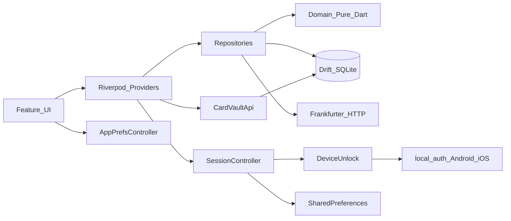

# Architecture

## Layers

Card screens reveal PAN/CVV only through `cardVaultApiProvider`. Onboarding constructs `DeviceUnlock` to ask whether OS biometrics exist. `domain/` does not import Flutter or Drift.

## Auth flow

1. `/onboarding` - market, handle, PIN, plus theme and locale (no profile yet)
2. Cold start when onboarded → `/lock` (PIN, or OS biometrics on Android/iOS)
3. Settings: lock, wipe and create a new account, biometrics toggle, theme, locale

`SessionController` keeps `onboarded` and `unlocked`. Logout locks. Create new account wipes the DB and the PIN. The router sends `onboarded && !unlocked` to `/lock`. The onboarded flag is SharedPreferences `mofobank_onboarded_v2`.

## Navigation

Tabs: Home `/home`, Missions `/missions`, Accounts `/accounts`, Wallet `/wallet`.

Other routes: `/settings`, `/boosts`, `/lock`, `/onboarding`, `/banking/open-deposit`, `/banking/transfer`, `/banking/card/:id`, `/mission/{cards,deposits,fx,atm,budgeting,transfers,credit,security,savings}`.

The Missions tab locks a chapter until the previous one is completed. Home quick tools open Cards, FX, and ATM without that lock. Accounts is the free-roam bank (cards, deposits, transfers).

## Persistence

Drift database name: `mofobank`. `schemaVersion` is 1.

Tables: Profiles, Accounts, BankCards, CardVaultSecrets, DepositAccounts, DirectoryUsers, LedgerEntries, MissionProgress, FxCache, BudgetItems, SavingsGoals.

Web requires `web/sqlite3.wasm` and `web/drift_worker.js`.

## Copy and appearance

Locales `en`, `ru`, `uz` via `lib/l10n`. `AppPrefsController` stores theme mode and locale in SharedPreferences and applies them in `MofoBankApp`, including before onboarding. Dark is the default theme. Light and system are selectable.